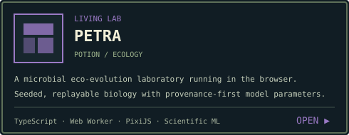

  

  
  
  
  

  

  
  

  
  

  

<strong>field notes / what I care about</strong>

 

I like systems that can explain themselves. That usually means preserving provenance, measuring performance instead of guessing, making failure modes visible, and refusing to hide uncertainty behind a polished UI.

A few recurring themes in my work:

- **Evidence-grounded AI** — retrieval, knowledge graphs, document intelligence, agentic workflows, and source-backed conclusions.
- **Systems engineering** — queues, workers, durable state, observability, recovery, and performance work that survives real workloads.
- **Compilers & runtimes** — static analysis, SSA, optimization, parallel execution, JIT/WASM, and measured correctness/performance.
- **Scientific & model research** — reproducible simulations, language-model experiments, careful benchmarks, and honest limitations.

If a project is interesting enough, I will probably benchmark it far past the point where a normal person would have stopped.

  <a href="https://github.com/Noel-Alex/AsterLM-Frontier">AsterLM Frontier</a> ·
  <a href="https://github.com/Noel-Alex/Oracle">ORACLE</a> ·
  <a href="https://github.com/Noel-Alex/sketchup-mcp">SketchUp MCP</a> ·
  <a href="https://github.com/Noel-Alex/portfolio">Portfolio source</a>

  

