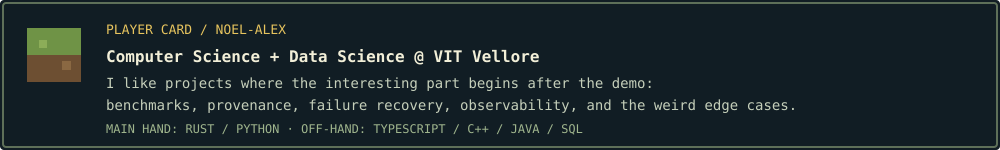
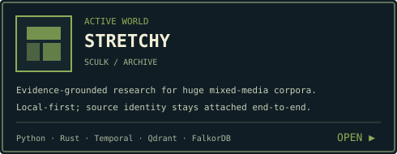
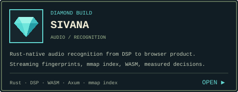
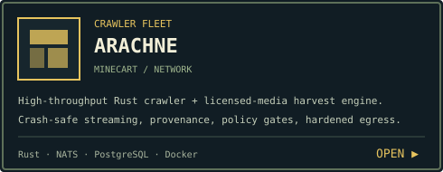
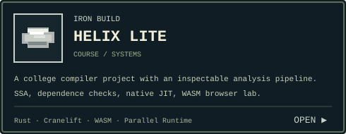
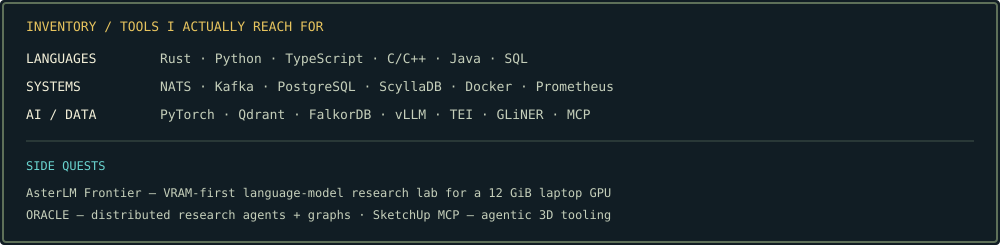

  

  
  
  

  

  
  

  
  

  

<strong>field notes / what I care about</strong>

 

I like systems that can explain themselves. That usually means preserving provenance, measuring performance instead of guessing, making failure modes visible, and refusing to hide uncertainty behind a polished UI.

A few recurring themes in my work:

- **Evidence-grounded AI** — retrieval, knowledge graphs, document intelligence, agentic workflows, and source-backed conclusions.
- **Distributed systems** — queues, workers, durable state, observability, recovery, and performance work that survives real workloads.
- **Search & retrieval** — crawling, indexing, ranking, vector search, graph search, and the plumbing that makes them useful.
- **Applied ML & scientific tooling** — reproducible experiments, careful benchmarks, simulations, and honest limitations.

If a project is interesting enough, I will probably benchmark it far past the point where a normal person would have stopped.

  

